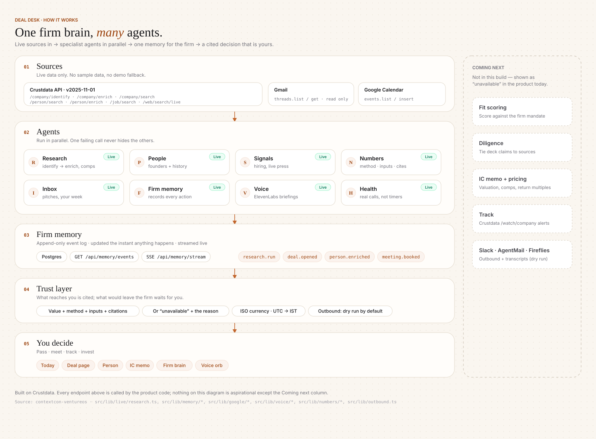

# Deal Desk

**Diligence that cites its sources: a company domain in, the evidence for an investment decision out.**

Deal Desk does the analyst work behind a VC or bank investment decision. It pulls live Crustdata on the company, its founders, its hiring and its press, and shows every number with its method, inputs and source, or says plainly that a value is unavailable. A person makes the call.

ContextCon 03 · IIT Bombay · theme **Investing** · team: Saurabh Gupta, Shiwani Mishra.

---

## 1. The service and who pays

| | |
|---|---|
| **Outcome sold** | A decision-ready diligence file for one company: who it is, who founded it and what they did before, how fast it is hiring, what the press says, and what the numbers are, each cited. The goal is an IC-ready memo and decision, not a research tool. |
| **Who pays** | VC associates and partners (first-pass screening, IC prep) · investment-bank and bank analysts (company profiles, comps) · diligence firms (commissioned company and founder checks) |
| **Why they pay today** | This work is done by salaried analysts or bought from diligence vendors, company by company. It is slow, repetitive and often uncited. Funds pay for data seats *and* the people who stitch the data together. |
| **What Deal Desk replaces** | The stitching: identify → enrich → founders → hiring → press → comps → a cited write-up, in one parallel run per company. |

## 2. What it does now, and where a person is still needed

Everything below exists in code at this commit. Pages are in `src/app/`; API routes are in `src/app/api/` (see `docs/API.md`).

| Page / route | What it does (live) |
|---|---|
| `/deal?domain=` (also `?tab=signals\|overview\|team\|market\|valuation`) | One research run: `/company/identify` → `/company/enrich`, then founders, jobs, live web news and comparables **in parallel** (`src/lib/live/research.ts:115-129`). The signal graph shows each Crustdata call, its fields, timing and request body. |
| `/person?linkedin=` | Founder profile and work history from Crustdata `/person/enrich` (reached from the Team tab) |
| `/memo?id=<domain>` | "IC memo" view of `GET /api/deals/:id/numbers`. Each row expands to show method, inputs and citations (`source · endpoint · path · retrieved`). |
| `/today` | Gmail inbox thread metadata (read-only), upcoming Google Calendar events, "Book a call" (dry run), today's firm memory, spoken greeting (ElevenLabs) |
| Memory button (every page) · `/brain` · `/pipeline` | Organisational memory: an append-only Postgres event log (`/api/memory/events`, SSE `/api/memory/stream`) of every research run, connector check and note |
| `/settings?section=connectors` | Real health checks per connector (`GET /api/integrations/connectors`), including Crustdata `/account/credits` (a free call, costs 0 credits) |
| Voice orb (every page except Today) | A spoken line about the current screen, built from the same data (`/api/voice/brief`, `/api/voice/tts`) |
| `/portfolio`, `/mandates`, `/agents`, `/ask`, `/slack`, `/deal/room` | Shown as **unavailable in this build**, with the reason. They are not faked. |

**Trust rules, enforced in code:**
- Numbers travel as `ComputedField`s (value, method, inputs, citations), or as "unavailable" plus a reason (`src/lib/fields.ts`, `src/live/field.tsx`).
- `src/test/guards.test.ts` fails the test run if production code imports test fixtures.

**Where a person is still needed:**

| Exception | What the app does |
|---|---|
| **The decision itself** | Fit score, recommendation, valuation and IC pricing are **"unavailable"**, with a reason (`src/lib/numbers/deal-numbers.ts`). Deal Desk assembles the cited evidence; a partner decides. |
| Unknown or unmatched company | "No Crustdata match for ‹domain›… Try the company name or its profile URL" (`port/src/components/signalgraph.tsx:426-427`). Nothing is invented. |
| Crustdata fails or rate-limits beyond the retry budget | "Couldn’t research ‹domain›: …" with a retry action (`src/live/deal.tsx:56`, `port/src/components/states.tsx:30`) |
| Anything that contacts a person | **Dry run by default.** With `OUTBOUND_MODE` unset or `dry_run`, booking a call builds the Calendar insert but sends nothing: "Dry run — not sent (event rules)" (`src/lib/outbound.ts:8-15`). Gmail send, Slack posts and AgentMail sends are not implemented. |

## 3. What's next, and why not now

| Next | Why not now |
|---|---|
| **Natural-language screening agent:** "find ten Indian B2B companies founded since 2023 whose team grew 50%…" → plan → `/company/search` + `/person/search` → `/company/enrich` → check each cell against the raw response → cited table <!-- TODO(Saurabh): finalise once nl-agent + rubric fixes merge --> | **Landing / in progress** on a feature branch (OpenAI GPT-6.1 Sol at high reasoning, streaming `POST /api/live/screen`). Not merged at this commit, and there is no UI page yet. |
| **Rubric fixes** (other open branches) <!-- TODO(Saurabh): finalise once nl-agent + rubric fixes merge --> | **Landing / in progress.** Not merged at this commit. |
| **Track ("not yet"):** watch a passed company and re-score it on funding or hiring changes, via Crustdata Watcher | The client exists (`src/lib/crustdata/client.ts:140-162`: create, delete and list runs), but there is **no `/api/webhooks/crustdata` route** to receive events, and webhooks need an HMAC check and replay protection first. |
| Fit scoring, IC recommendation, valuation | Needs the firm's thesis and mandate, plus the builder pipeline. Crustdata does not provide revenue multiples, so we show "unavailable" instead of a guess. |
| Crustdata MCP server | Not used. Our agents call the REST API directly through one client. |
| **Warm forward** (pass with an intro to a better-fit investor) | Parked by design: deck confidentiality, founder consent, "passed by X" stigma. It would need double opt-in and drafts only. |
| Live outbound (Gmail, Slack, AgentMail) | Event rule: agents contact only our team, Crustdata and Techfest. Everything stays dry run. |

## 4. How to run it, and how it's built

```bash
npm ci
cp .env.example .env.local   # fill in what you have; anything missing shows "not connected"
npm run dev                  # http://localhost:3240
npm test                     # vitest (17 test files, no network; Crustdata tests replay captured responses)
npm run typecheck
npm run build && npm start   # :3240
npm run crustdata:test:live  # optional live contract test (spends credits)
```

**Env var names** (from `.env.example`; values are never committed):
- Crustdata and cache: `CRUSTDATA_API_KEY` · `DEALDESK_CACHE_DIR` · `DEALDESK_CACHE_TTL_SECONDS`
- Memory: `DATABASE_URL`
- Google: `GOOGLE_CLIENT_ID` · `GOOGLE_CLIENT_SECRET` · `GOOGLE_REFRESH_TOKEN`
- Outbound: `OUTBOUND_MODE`
- Voice: `ELEVENLABS_API_KEY` · `ELEVENLABS_VOICE_ID` · `ELEVENLABS_MODEL_ID` · `DEALDESK_GREETING_NAME`
- LLM: `ANTHROPIC_API_KEY` · `DEALDESK_LLM_MODEL`
- Status-only connectors: `AGENTMAIL_API_KEY` · `SLACK_BOT_TOKEN` · `FIREFLIES_API_KEY`

Stack: Next.js 15, React 19, Tailwind 4, Postgres (`postgres`), vitest.

### Architecture



PNG fallback: [docs/architecture/architecture.png](docs/architecture/architecture.png) · Mermaid source: [architecture.mmd](docs/architecture/architecture.mmd)

### The stack (bottom to top)

| Layer | What's in it |
|---|---|
| **05 · You decide** | Today · Deal · Person · IC memo · Firm brain · voice orb. The partner makes the call. |
| **04 · Trust layer** | Every value comes with method, inputs and citations, or "unavailable" plus a reason. ISO currency, UTC stored and shown in IST, outbound dry run by default. |
| **03 · Firm memory** | Append-only Postgres event log: `GET/POST /api/memory/events`, SSE `/api/memory/stream` |
| **02 · Agents** | Specialists running in parallel per request (table below) |
| **01 · Sources** | Live only: Crustdata API `2025-11-01`, Gmail (read-only), Google Calendar |

### The agents

| Agent | Job | Tools / Crustdata endpoints | Status |
|---|---|---|---|
| Research | Domain → cited company profile, comparables | `/company/identify`, `/company/enrich`, `/company/search` | Live |
| People | Founders and their full work history | `/person/search`, `/person/enrich` | Live |
| Signals | Hiring by function, live press (off-topic hits dropped) | `/job/search`, `/web/search/live` | Live |
| Numbers | Headcount, growth, last round, each as a `ComputedField` | derived from enrich; `src/lib/numbers/` | Live (valuation and fit are "unavailable") |
| Inbox | Pitch threads and your week; books calls as a dry run | Gmail `threads.list/get`, Calendar `events.list/insert` | Live |
| Voice | Greeting and per-screen briefings | ElevenLabs TTS; optional Anthropic rephrase (`DEALDESK_LLM_MODEL`) | Live |
| Health | Checks every connector with a real call | Crustdata `/account/credits` (free call), provider ping endpoints | Live |
| NL screener <!-- TODO(Saurabh): finalise once nl-agent + rubric fixes merge --> | Natural-language request → verified, cited shortlist | `/company/search`, `/person/search`, `/company/enrich`, `/person/enrich`; OpenAI GPT-6.1 Sol (high reasoning) | **Landing** |

### Where it calls Crustdata

Single client: `src/lib/crustdata/client.ts` → `src/lib/crustdata/http.ts`. Base URL `https://api.crustdata.com` (`http.ts:7`).

| Endpoint | Client method | Called from | Feature |
|---|---|---|---|
| `POST /company/identify` | `client.ts:95-98` | `src/lib/live/research.ts:44` | `/deal`, `/memo`, `/api/live/research`, `/api/live/company`, `/api/deals/:id/*` |
| `POST /company/enrich` | `client.ts:100-103` | `research.ts:52` | same as above |
| `POST /person/search` | `client.ts:110-113` | `research.ts:66` | Team tab (founders), `/api/live/people` |
| `POST /job/search` | `client.ts:120-123` | `research.ts:76` | Signals (hiring), `/api/live/jobs` |
| `POST /web/search/live` | `client.ts:125-128` | `research.ts:86` | Evidence (news), `/api/live/news` |
| `POST /company/search` | `client.ts:105-108` | `research.ts:99` | Market tab (comparables), `/api/live/comps` |
| `POST /person/enrich` | `client.ts:115-118` | `research.ts:107` | `/person?linkedin=`, `/api/live/person` |
| `GET /account/credits` | `client.ts:131-134` | `src/lib/live/integrations.ts:70` | Settings › Connectors health check |
| `POST/DELETE /watch/company`, `GET …/runs` | `client.ts:140-162` | none (tests only) | Not wired (see §3) |

- **Version header:** `x-api-version: 2025-11-01`, set in `http.ts:6`, sent in `http.ts:98`.
- **429 handling:** waits on `Retry-After` / `X-RateLimit-Reset`, otherwise `2^attempt` s plus jitter (`rate-limit-headers.ts`). Up to **3 retries** with at most **15 s** of total waiting (`http.ts:79-80`, loop at `http.ts:118-126`), then an honest error. A timed-out POST is not replayed, because it may already have been billed (`http.ts:102-111`).
- **Client-side limiter:** a per-route sliding window (`rate-limits.ts`: enrich 15/min, search 30/min, web 10/min).
- **Cache:** read-only calls are cached for 6 h (`cache.ts`).

## 5. What we tried, what worked, what failed

Sources: our live Crustdata audit on 31 Oct (≈10:05–10:55 IST), commit history, and `verify_shots/REPORT.md`.

| Tried | Result | What we did |
|---|---|---|
| `/company/search` with a flat `filters:{industries, employee_count_range}` object | **400** `filter_shape` ("must be either a single condition … or a tree"). The code also read `.results` instead of `companies`. A second shape gave **400** "Unsupported columns in conditions: ['industries']". | Hybrid `search:{query, mode:"hybrid"}` plus `crustdata_company_id not_in [self]` returned 200 for 0.09 credits. Ported as the comps query (`a04e8be`, `src/lib/crustdata/company-queries.ts`). |
| `/person/search` and `/job/search` with flat filters | **400** `filter_shape` on every shape. `limit:0` was rejected. The deal build crashed because nothing caught the error. | `{op, conditions}` filter trees, `limit ≥ 1`, and per-call isolation so one failure doesn't hide the rest (`research.ts:31-38`) |
| `/company/enrich` with no `fields` | 200, but only `basic_info`, and still 2 credits | Request only the permitted field groups (`enrich-fields.ts`). Asking for a denied field fails the whole call with 403. |
| Unknown domain on `/company/identify` | 200 with `matches: []`, which an old smoke test counted as a pass | Explicit `no_match`, with an honest UI card |
| Burst of identify calls | **429** with no `Retry-After` header, and `x-ratelimit-reset` in seconds. An early client could stall about 50 s and attached a retry hint even to 400s. | Bounded 429 waits (3 retries / 15 s), retry hint only on 429, sliding-window limiter (`a04e8be`) |
| `POST /watch/company` with array `entities`/`track` | **400**. The old code also leaked a real watch pointing at `example.com` on each run. | Fixed the body (`watch-body.ts`). The client refuses to create a watch without a real webhook URL. Receiving events is still not built (§3). |
| Imported UI ran on hand-written sample data (`port/src/fixtures`: 25 files, 3,144 lines), plus a hard-coded "7.5–8.5x EV/ARR" band and connectors that turned "Connected" on a timer | It looked right but was wrong: e.g. headcount 45 vs 52 live | Removed the demo and fixture modes (`ccf42bf`). Moved the samples to test-only `port/test/fixtures` behind a guard test (`790faaa`). Unknown values now show "unavailable". |
| Server-rendered speech-recognition check | React hydration error #418 on `/` and `/today` | Decide after mount (`e32cc4c`). The final click-through of 26 routes had 0 console errors (`25c3316`). |
| Voice autoplay | Headless Chromium wouldn't reproduce a block | A simulated `NotAllowedError` shows "Tap to hear" (`scripts/verify-autoplay-blocked.mjs`). This was not tested in a real blocking browser. |
| Live web search | 4–7 s and noisy (wrong "E2B" hits, redirect wrappers) | Off-topic filter (`34a755e`) |

**Still open:** no end-to-end live run from inbound to IC to portfolio. Fit, recommendation and valuation are unavailable. No webhook receiver. `npm run shots` and `npm run crustdata:smoke` point at scripts that are not in `scripts/`. `OPENAI_API_KEY` and `DEALDESK_PUBLIC_URL` are read by the code but missing from `.env.example`.

---

## Honest note: work that predates 10:30 AM IST

The rules say code is written from 10:30 AM IST on 31 Oct. Every commit in this repo is dated after that: the first is 10:53 IST. **But some of the code was written before 10:30**, and we want that to be plain.

**Existed before 10:30 IST on 31 Oct:**

| What | Evidence | Size |
|---|---|---|
| The Deal Desk web UI (screens, components, logos, Next.js shell), imported in the root commit `451e4d9` "Deal Desk web UI as deployed to contextcon.ventureos.xyz" (committed 10:53 IST) | `git show --stat 451e4d9` | **259 files, 20,048 lines**: `port/` 161 files / 16,672 lines (screens, components, the 25 sample-data files, logos) · `public/` 70 files / 111 lines (logos) · `src/` 19 files / 474 lines (route shells) · 9 root files / 2,791 lines (mostly `package-lock.json`) |
| Its design history: a separate local mock-up repo whose first commit is at **30 Oct 23:31 IST**, with 7 commits through **31 Oct 08:17 IST** (v1 → v3.2 redesign) | That repo's git reflog | — |
| A Crustdata backend ("builder repo") with the client, query builders, rate limits and cache. Our live audits ran against it at about **10:05–10:25 IST** (audit chunks timestamped **10:12–10:19 IST**). | Audit notes | Its client was ported in `a04e8be` (below) |

**Built today, after 10:30 IST** (`git log`, times in IST):

| Time | Commit | What | Files | +/− |
|---|---|---|---|---|
| 10:53 | `451e4d9` | Import of the pre-existing UI (above) | 259 | +20,048 |
| 11:03 | `3ed5f36` | Integration plan | 1 | +123 |
| 11:10 | `a04e8be` | **Port** of the Crustdata client from the builder repo, with fixes; regenerated OpenAPI types (~14k lines of YAML and generated TS), captured responses for tests | 55 | +20,416 / −173 |
| 11:23 | `34a755e` | Live API routes: research, people, person, jobs, news, comps, integrations | 24 | +1,040 / −29 |
| 11:29 | `70d9dea` | Live Settings › Connectors | 12 | +304 / −14 |
| 11:30 | `d63a56c` | `ComputedField` contract, `/api/deals/:id/numbers` and `/valuation` | 13 | +466 / −12 |
| 11:41 | `50183ba` | `docs/API.md` | 1 | +149 |
| 11:42 | `4b0a852` | Live `/deal?domain=` | 9 | +496 / −24 |
| 11:47 | `e6c3a55` | Live `/person?linkedin=` | 3 | +103 / −1 |
| 12:12 | `82875ff` | Organisational memory (Postgres), IST and money formatter | 35 | +449 / −1 |
| 12:22 | `ccf42bf` | Removed demo and fixture modes | 33 | +214 / −458 |
| 12:22 | `790faaa` | UI without fixtures: unavailable states, memory panel, explainable valuation and memo | 77 | +1,056 / −472 |
| 12:30 | `53d6384` | Voice greeting and orb (ElevenLabs) | 17 | +958 / −7 |
| 12:36 | `bf68800` | Gmail and Google Calendar connectors | 18 | +715 / −28 |
| 12:39 | `bb45486` | `OUTBOUND_MODE` dry run by default | 6 | +70 / −12 |
| 12:40 | `95d019c` | Docs, `.env.example` | 4 | +170 / −144 |
| 12:41 | `be4f7b8` | Ignore local settings | 1 | +3 |
| 12:43 | `e32cc4c` | Hydration fix, `?tab=valuation` | 4 | +9 / −4 |
| 12:46 | `25c3316` | Live click-through verification, autoplay check, credit ledger | 40 | +164 |
| 12:46 | `7886cd7` | Report commit list | 1 | +15 |
| 13:15 | `accaf77` | Architecture diagram | 4 | +236 |

Landing / in progress after this: the NL screening agent and rubric fixes on feature branches. <!-- TODO(Saurabh): finalise once nl-agent + rubric fixes merge -->
