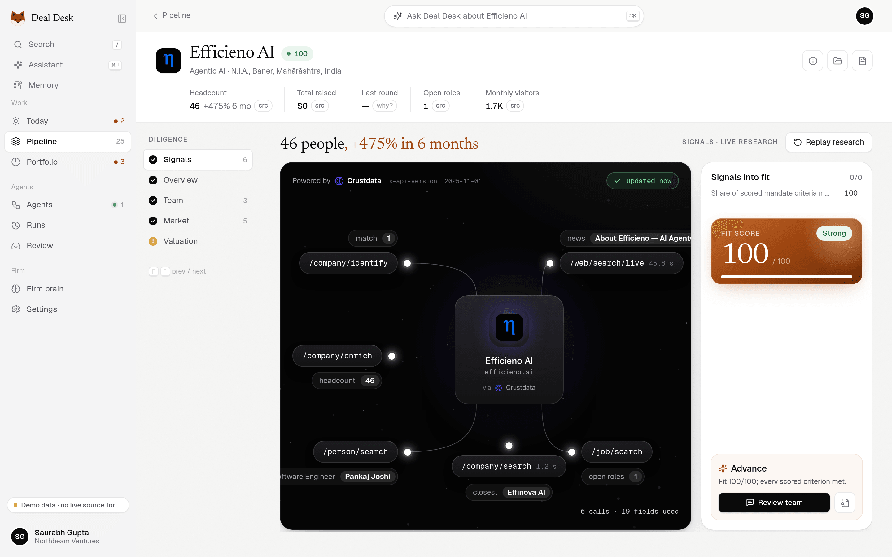
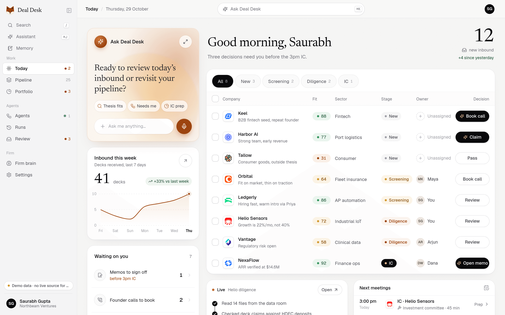
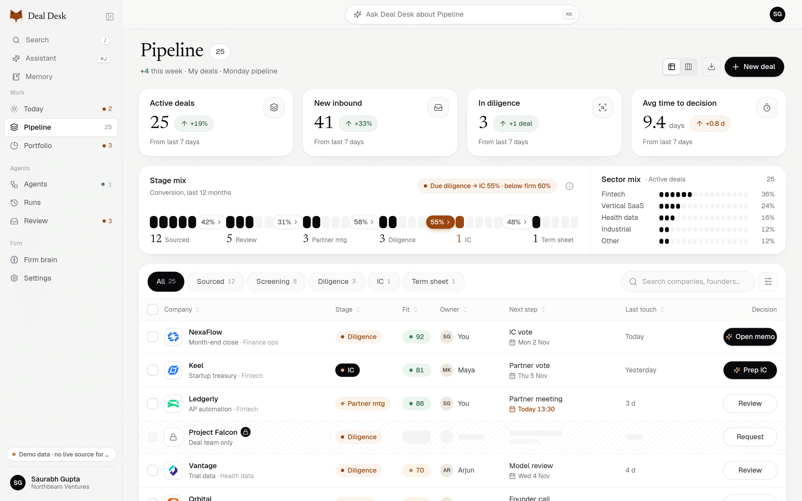
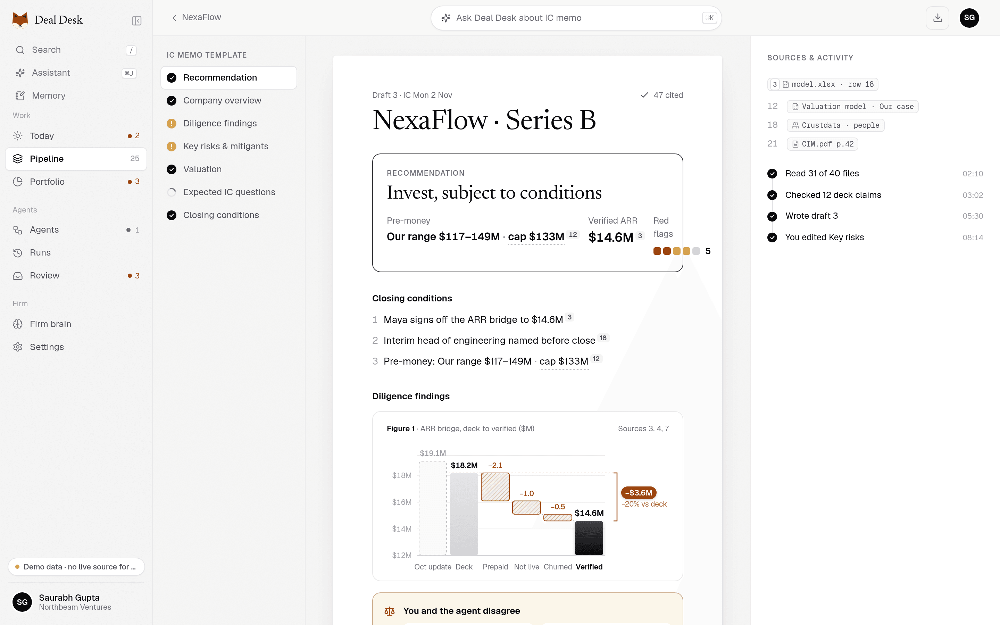
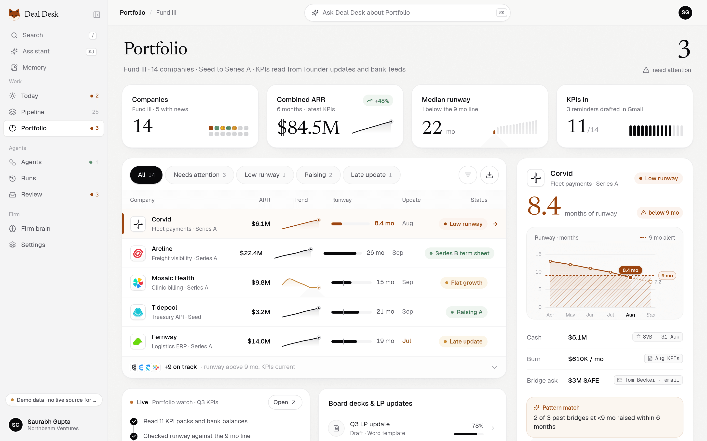
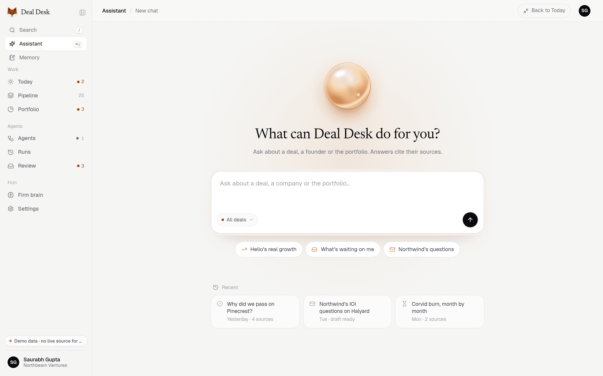
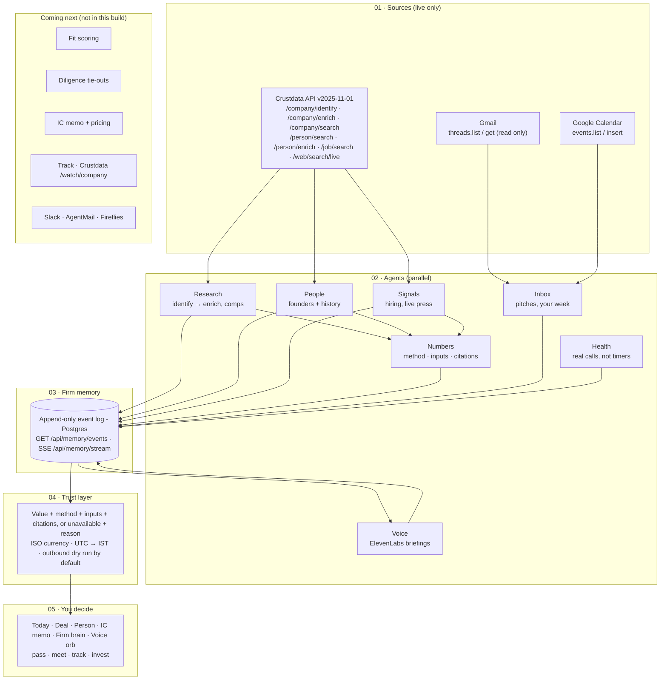

# Deal Desk

> ## 🚀 Live demo: **[contextcon.ventureos.xyz](https://contextcon.ventureos.xyz)**
> Try it now: [Today inbox](https://contextcon.ventureos.xyz/today) · [Ask](https://contextcon.ventureos.xyz/ask) · [Detailed system diagram](docs/architecture/SYSTEM_DIAGRAM.md)

  
   
  <b>Deal page, live Crustdata.</b> Deal Desk calls Crustdata for Efficieno AI. Each number shows its source. <a href="https://contextcon.ventureos.xyz/deal?domain=efficieno.ai">Open the live page →</a>

**Deal Desk is an agentic OS for venture investors. It uses live Crustdata to check a founder's claims and turn them into a cited investment decision and IC memo.**

Team **thExplorers**: Saurabh Gupta, Shiwani Mishra · ContextCon 03 @ IIT Bombay (Techfest), 31 Oct 2026 · Theme: **Investing**

> **Trust rule:** Each number shows its value, method, inputs and source. If a number has no source, the screen shows "unavailable" and the reason.

## Screenshots

These screenshots come from the live site, [contextcon.ventureos.xyz](https://contextcon.ventureos.xyz). Click an image to open the page.

<table>
  <tr>
    <td width="50%" valign="top">
      
       <b>Today.</b> See the new inbound deals and the decisions for today.
    </td>
    <td width="50%" valign="top">
      
       <b>Pipeline.</b> Follow each deal from sourced to term sheet.
    </td>
  </tr>
  <tr>
    <td width="50%" valign="top">
      
       <b>IC memo.</b> Read the recommendation. Each number has a citation.
    </td>
    <td width="50%" valign="top">
      
       <b>Portfolio.</b> Monitor runway, ARR and alerts for each company.
    </td>
  </tr>
  <tr>
    <td width="50%" valign="top">
      
       <b>Ask.</b> Ask a question in plain English. The answer cites its sources.
    </td>
    <td width="50%"></td>
  </tr>
</table>

> **Note:** The deal page uses live Crustdata. Some other screens show sample data. A "Demo data" badge identifies sample data.

## 1. The service

**The service:** Deal Desk does the work of a VC analyst or associate. This work is deal sourcing, screening, diligence and the IC memo.

**Who does it today:** Analysts and associates at early-stage VC funds do this work. Some funds pay outside research firms to do part of it.

**The job today:**

- An analyst reads founder emails and finds companies that fit the fund thesis.
- The analyst searches company data and checks the founder's claims (team size, growth, funding).
- The analyst finds the founders and their work history.
- The analyst writes a memo with sources for the partners.
- This work takes many days for each deal.

**Who pays:** The fund pays. The money comes from the fund's management fee. One seat of Deal Desk must save more analyst hours than it costs. Crustdata credits pass through at cost. We did not test this price with a customer.

## 2. What it does now

Deal Desk does these steps from start to end:

| Step | What Deal Desk does | Code |
| --- | --- | --- |
| 1. Request intake | Reads a plain-English request (`/ask`, `/agent`, or voice). Reads founder emails and calendar events from Gmail and Google Calendar (read only) on `/today`. | `src/live/ask.tsx`, `src/lib/sourcing`, `src/lib/google` |
| 2. Screening | Finds companies with Crustdata search. If too few companies match, it relaxes one filter and tells you which filter. | `src/lib/sourcing/run.ts`, `src/lib/agent` |
| 3. Research and claim checks | Gets headcount, growth, funding, web traffic, open roles and founders from Crustdata. It recalculates growth from the headcount time series. The server checks each value against the cited Crustdata response. | `src/lib/live/research.ts`, `src/lib/numbers` |
| 4. Founders | Finds founders and their past employers. | `src/lib/crustdata/person-queries.ts` |
| 5. Ranked, cited table | Ranks the companies. Each cell shows its Crustdata endpoint and JSON path. Exports a memo (markdown) and CSV. | `src/live/agent`, `src/live/screen` |
| 6. Valuation and IC memo | Calculates a valuation from the deal's cited Crustdata numbers when the inputs exist. Fit score, verdict and IC-memo figures come from a separate decision engine. | `src/lib/numbers/decisions.ts`, `GET /api/deals/:id/decisions` |
| 7. Exceptions | Sends unclear matches, missing data, conflicting data and high credit cost to a review queue. | `/review`, `src/lib/exceptions` |
| 8. Firm memory | Records each action in an append-only event log. | `src/lib/memory`, `/api/memory/*` |

**Where it still needs a person:**

- A partner approves each email and each calendar booking before it goes out.
- A partner makes the Invest or Pass decision.
- A partner sets up the fund mandate (`/mandates`, `/api/settings/mandate`, or `MANDATE_JSON`).
- A person resolves each item in the `/review` queue.

**Limits of this build (honest):**

- **Data mode.** `DEALDESK_DATA_MODE` is `demo` when it is not set. In demo mode, most screens show sample data from `port/src/fixtures` with a "Demo data" badge, and `/api/live/*` is off. Set `DEALDESK_DATA_MODE=live` to use live Crustdata.
- **Outbound is dry run.** Deal Desk builds emails and invites but does not send them. It sends only when `OUTBOUND_MODE=live`, the recipient is on `DEMO_RECIPIENT_ALLOWLIST`, and a person clicks Approve.
- **Gmail is read only.** Deal Desk does not start a deal automatically from a new email.
- **No meeting note-taker is connected.** Fireflies shows status only.
- **Decision engine.** If `DEALDESK_BUILDER_URL` is not set, fit score, verdict and IC-memo figures show "unavailable" with the reason.

## 3. What it could do next

| Next | What it does | Why not now |
| --- | --- | --- |
| Live Gmail intake | Each new founder email starts a deal automatically. | It needs Gmail write scopes and a privacy review of founder data. |
| Meeting note-taker | Records the partner call and checks each claim in the transcript against Crustdata. | It needs founder consent to record. The event rules limit contact to the team, Crustdata and Techfest. |
| Better comparables for valuation | Uses more real comparable deals for the valuation range. | It needs more data access and more Crustdata credits per deal. |
| Firm memory that learns | Uses past Invest and Pass decisions to rank new deals. | It needs many real decisions. A few hackathon decisions are not enough data. |
| Real sends | Sends data-room requests and meeting invites. | Trust comes first. Each send must stay behind a person's approval until the output is proven. |
| Track with Crustdata watches | Tells the partner when a company reaches a milestone (`/watch/company`). | It needs a public webhook URL with HMAC checks and a deal store. |

We kept these out of the hackathon scope. Each one sends data out of the firm or acts for the partner. Approval gates and privacy rules must come first.

## 4. How to run it, and how it is built

### Run it

1. Clone the repo: `git clone https://github.com/saurabh4269/contextcon-ventureos.git && cd contextcon-ventureos`
2. Install the packages: `npm install`
3. Copy the environment file: `cp .env.example .env.local`
4. Add your keys to `.env.local`. Use placeholders such as `CRUSTDATA_API_KEY=<your-key>`. Do not commit this file.
5. To use live data, set `DEALDESK_DATA_MODE=live`.
6. Start the app: `npm run dev:demo`. Open http://localhost:3000.
7. Run the tests: `npm test` (vitest, no network). Run the type check: `npm run typecheck`.
8. Check your keys: `npm run doctor`.

For full setup on Windows, Mac or Linux, read [SETUP_LOCAL.md](SETUP_LOCAL.md). For project context, read [docs/context/](docs/context/README.md).

**Try these (live mode):**

| Go to | What happens |
| --- | --- |
| `/ask` | The research agent plans, calls Crustdata, checks each value and shows a ranked, cited table. |
| `/agent` | The sourcing agent (no model) shows what it understood, runs live Crustdata steps and shows credits used. |
| `/deal?domain=e2b.dev` | Live research on one company. Click a number to see its method and source. |
| `/deal?domain=zz9-no-such-startup-qx7.com` | Shows "No Crustdata match". It does not show a fake company. |
| `/review` | The exception queue. Approve, edit or reject each item. |
| `/settings` | Real connector health checks. |

### How it is built

- **App:** Next.js 15 (App Router), React 19, TypeScript, Tailwind 4. It runs on Vercel.
- **Models:** OpenAI GPT models through the Responses API with function tools. The research agent (`/ask`) uses a model to plan and call Crustdata tools (`OPENAI_MODEL`, `OPENAI_REASONING_EFFORT`). If no model key is set, `/ask` offers the deterministic sourcing agent (`/agent`). Anthropic is used instead when `ANTHROPIC_API_KEY` is set.
- **Deterministic code:** The sourcing agent, ranking, numbers and memo text are code over live data. They do not use a model.
- **Data:** Crustdata API for company, person, job and web data. Gmail and Google Calendar through Google OAuth (read; calendar insert only after approval). ElevenLabs for voice.
- **Firm memory:** Postgres (`DATABASE_URL`). If it is not set, the memory panel says "memory store not configured".
- **Trust layer:** Each number is a `ComputedField` (value, method, inputs, citations) or "unavailable" with a reason (`src/lib/fields.ts`).

**Agents:**

| Agent | What it does | Code |
| --- | --- | --- |
| Research (LLM) | Plans, calls Crustdata tools, checks each value against its cited response. | `src/lib/agent`, `POST /api/live/screen` |
| Sourcing (no model) | Request → filters → search → verify → founders → ranked, cited table. | `src/lib/sourcing`, `POST /api/sourcing/run` |
| Company research | Identify → enrich, then founders, jobs, web and comparables in parallel. | `src/lib/live/research.ts` |
| Numbers | Turns raw responses into cited fields and a valuation. | `src/lib/numbers` |
| Inbox | Reads Gmail threads and Calendar events. | `src/lib/google` |
| Voice | Greeting, speech-to-text, read-aloud summary. | `src/lib/voice`, `src/live/voice` |
| Memory | Records each action in the event log. | `src/lib/memory` |

### Where it calls Crustdata

All calls go through one client: `src/lib/crustdata/client.ts` → `src/lib/crustdata/http.ts`. It calls `https://api.crustdata.com` with a bearer token and the header `x-api-version: 2025-11-01`. The client has a rate limiter per route, capped retries, a cache and a backup key (`CRUSTDATA_API_KEY_BACKUP`).

| Crustdata endpoint | Code that calls it | API routes that use it |
| --- | --- | --- |
| `POST /company/identify` | `src/lib/live/research.ts`, `src/lib/live/resolve.ts`, agent tool `identify_company` | `/api/live/company`, `/api/live/research`, `/api/live/screen`, `/api/sourcing/run` |
| `POST /company/enrich` | `src/lib/live/research.ts`, `src/lib/sourcing/run.ts`, `src/lib/crustdata/enrich-fields.ts` | `/api/live/company`, `/api/live/research`, `/api/live/screen`, `/api/sourcing/run`, `/api/deals/[id]/numbers`, `/api/deals/[id]/valuation`, `/api/deals/[id]/decisions` |
| `POST /company/search` | `src/lib/crustdata/company-queries.ts`, `src/lib/sourcing/run.ts` | `/api/live/comps`, `/api/live/screen`, `/api/sourcing/run` |
| `POST /person/search` | `src/lib/crustdata/person-queries.ts`, `src/lib/crustdata/person-search.ts` | `/api/live/people`, `/api/live/screen`, `/api/sourcing/run` |
| `POST /person/enrich` | `src/lib/live/research.ts` | `/api/live/person`, `/api/sourcing/run` |
| `POST /job/search` | `src/lib/crustdata/job-queries.ts` | `/api/live/jobs`, `/api/live/screen` |
| `POST /web/search/live` | `src/lib/live/research.ts`, `src/lib/agent/tools/web-search.ts` | `/api/live/news`, `/api/live/screen` |
| `GET /account/credits` | `src/lib/live/integrations.ts` | `/api/integrations/connectors` |
| `/watch/company` | `src/lib/crustdata/client.ts` (`watchCompany`, not called yet) | none yet |

A fresh research run on one company (e2b.dev) used 5.56 credits. Full audit: [docs/CRUSTDATA_USAGE.md](docs/CRUSTDATA_USAGE.md). Robustness details: [docs/ROBUSTNESS.md](docs/ROBUSTNESS.md).

### Architecture

This diagram shows the build in this branch. The [detailed system diagram](docs/architecture/SYSTEM_DIAGRAM.md) shows the full target workflow.

## 5. The approaches we tried

| We tried | What happened | What we chose, and why |
| --- | --- | --- |
| Demo/fixture data next to live data | At 12:22 IST we removed fixture mode (`ccf42bf`). A judge or partner could not tell sample numbers from real numbers. Later, a demo mode came back as the default UI (`641074d`), with a "Demo data" badge. | Live mode follows the trust rule. Demo mode is labelled on screen, so a user can see that the data is sample data. |
| One deterministic request parser (no model) | It was easy to audit. But it missed constraints in unusual wording. | We kept it as `/agent`, the no-model fallback. We added the LLM research agent `/ask`. The server checks each value that the model cites. |
| Model answers without checks | A model can invent numbers. | The server resolves each cited value. It marks the value verified, corrected or unavailable. |
| The builder's full backend | Its search request bodies failed with 400 `filter_shape`. It needed its own database. | We ported only the Crustdata client. We rewrote each request to the documented shape and tested it live. |
| `/company/enrich` without `fields` | It returned only basic data and still cost 2 credits. One denied field caused a 403 for the full call. | We always send an allow-list of permitted fields. |
| `hiring.*` from enrich as the hiring signal | The values were null for our test companies. | Open roles come from `/job/search`. |
| Many features at the same time | Parallel work caused README conflicts near the freeze. | One owner for the README. One problem: the analyst's path from request to cited decision. |
| Send emails from agents | The event rules allow contact only with the team, Crustdata and Techfest. | Outbound is dry run by default. A person must approve each send. |
| A voice agent that answers from its own model | Its spoken facts would have no source. | Speech-to-text feeds the request box. Text-to-speech reads a summary of cited data. The voice agent can only open screens or start a run. |
| A watch on each research run | It left watches open and cost credits for each notification. | We removed watch creation from page loads. Track is in "next". |

Decision log: [docs/DECISIONS.md](docs/DECISIONS.md).

## Trust rules (in code)

| Rule | Where |
| --- | --- |
| Each number is a `ComputedField` or "unavailable" with a reason | `src/lib/fields.ts`, `src/live/field.tsx` |
| No hard-coded amounts, percentages, dates or counts in live screens | `src/test/guards.test.ts` |
| Money is `{amount, currency}`. No conversion without a cited FX rate | `src/lib/format` |
| Times are stored in UTC and shown in IST | `src/lib/format` |
| Outbound is dry run unless `OUTBOUND_MODE=live`, an allowlisted recipient and a person's approval | `src/lib/outbound.ts` |
| Secrets stay on the server. Status shows env var names, not values | route handlers, `src/lib/live/integrations.ts` |
| An error never shows as "no match". "No match" never shows as a company | `src/lib/live/research.ts` |

## Team

| Name | Role | GitHub |
| --- | --- | --- |
| Saurabh Gupta | Product, engineering | [saurabh4269](https://github.com/saurabh4269) |
| Shiwani Mishra | Team member | — |

## Code history (honest note): work that predates 10:30 AM IST

The rules say code is written from 10:30 AM IST on 31 Oct. Every commit in this repo is dated after that: the first is 10:53 IST. **But some of the code was written before 10:30**, and we want that to be plain.

**Existed before 10:30 IST on 31 Oct:**

| What | Evidence | Size |
|---|---|---|
| The Deal Desk web UI (screens, components, logos, Next.js shell), imported in the root commit `451e4d9` "Deal Desk web UI as deployed to contextcon.ventureos.xyz" (committed 10:53 IST) | `git show --stat 451e4d9` | **259 files, 20,048 lines**: `port/` 161 files / 16,672 lines (screens, components, the 25 sample-data files, logos) · `public/` 70 files / 111 lines (logos) · `src/` 19 files / 474 lines (route shells) · 9 root files / 2,791 lines (mostly `package-lock.json`) |
| Its design history: a separate local mock-up repo whose first commit is at **30 Oct 23:31 IST**, with 7 commits through **31 Oct 08:17 IST** (v1 → v3.2 redesign) | That repo's git reflog | — |
| A Crustdata backend ("builder repo") with the client, query builders, rate limits and cache. Our live audits ran against it at about **10:05–10:25 IST** (audit chunks timestamped **10:12–10:19 IST**). | Audit notes | Its client was ported in `a04e8be` (below) |

**Built today, after 10:30 IST** (`git log`, times in IST):

| Time | Commit | What | Files | +/− |
|---|---|---|---|---|
| 10:53 | `451e4d9` | Import of the pre-existing UI (above) | 259 | +20,048 |
| 11:03 | `3ed5f36` | Integration plan | 1 | +123 |
| 11:10 | `a04e8be` | **Port** of the Crustdata client from the builder repo, with fixes; regenerated OpenAPI types (~14k lines of YAML and generated TS), captured responses for tests | 55 | +20,416 / −173 |
| 11:23 | `34a755e` | Live API routes: research, people, person, jobs, news, comps, integrations | 24 | +1,040 / −29 |
| 11:29 | `70d9dea` | Live Settings › Connectors | 12 | +304 / −14 |
| 11:30 | `d63a56c` | `ComputedField` contract, `/api/deals/:id/numbers` and `/valuation` | 13 | +466 / −12 |
| 11:41 | `50183ba` | `docs/API.md` | 1 | +149 |
| 11:42 | `4b0a852` | Live `/deal?domain=` | 9 | +496 / −24 |
| 11:47 | `e6c3a55` | Live `/person?linkedin=` | 3 | +103 / −1 |
| 12:12 | `82875ff` | Organisational memory (Postgres), IST and money formatter | 35 | +449 / −1 |
| 12:22 | `ccf42bf` | Removed demo and fixture modes | 33 | +214 / −458 |
| 12:22 | `790faaa` | UI without fixtures: unavailable states, memory panel, explainable valuation and memo | 77 | +1,056 / −472 |
| 12:30 | `53d6384` | Voice greeting and orb (ElevenLabs) | 17 | +958 / −7 |
| 12:36 | `bf68800` | Gmail and Google Calendar connectors | 18 | +715 / −28 |
| 12:39 | `bb45486` | `OUTBOUND_MODE` dry run by default | 6 | +70 / −12 |
| 12:40 | `95d019c` | Docs, `.env.example` | 4 | +170 / −144 |
| 12:41 | `be4f7b8` | Ignore local settings | 1 | +3 |
| 12:43 | `e32cc4c` | Hydration fix, `?tab=valuation` | 4 | +9 / −4 |
| 12:46 | `25c3316` | Live click-through verification, autoplay check, credit ledger | 40 | +164 |
| 12:46 | `7886cd7` | Report commit list | 1 | +15 |
| 13:15 | `accaf77` | Architecture diagram | 4 | +236 |

After 13:15 IST (see `git log`): the shell (collapsible sidebar, mobile drawer, Dex mascot, account menu), ElevenLabs speech-to-text and the conversational voice session, the deterministic Sourcing agent (`/agent`), the LLM research agent (`/ask`), Crustdata resilience (retries, deadlines, circuit breaker, stale-cache fallback, did-you-mean), the exception review queue (`/review`), the reasons-and-sources panel and citation enforcement, the responsive pass, and these docs.

Authorship: 14 early commits were first recorded under the default git identity of the coding-agent environment the team used (not a team member), and some carried coding-assistant `Co-authored-by` trailers. Before submission the history was re-attributed to Saurabh Gupta (author and committer) and those trailers removed; commit contents and timestamps are unchanged. Design references, plans and research notes from before the event are allowed by the rules and are not in this repo.
