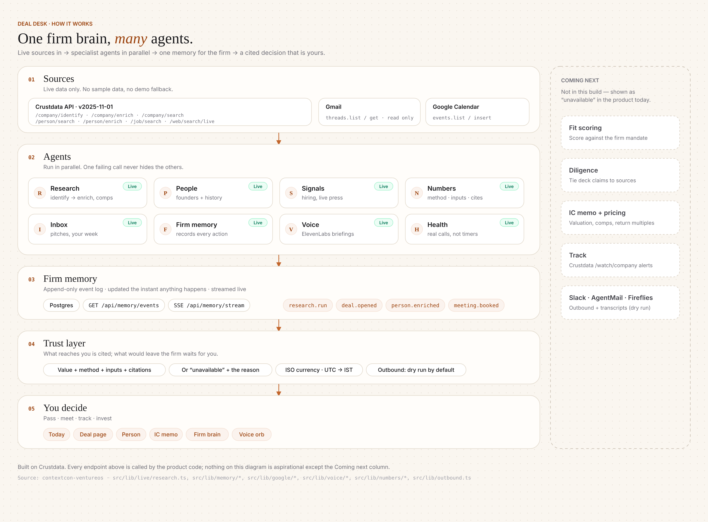

# Deal Desk

**An agentic OS for venture investors, built on Crustdata: type or say a sourcing request, get a ranked, cited shortlist and a memo.**

> **The trust rule:** every number on screen is live, computed and cited (value, method, inputs, source), or it says
> "unavailable" and why. No demo data, no fixtures, no invented fallbacks, and nothing leaves the firm (outbound is dry-run).

ContextCon @ IIT Bombay (Techfest), 31 Oct 2026 · Theme: **Investing** · Team: Saurabh Gupta, Shiwani Mishra



## Quick start

Full local setup on Windows, Mac or Linux (one command, keys checked before start): [SETUP_LOCAL.md](SETUP_LOCAL.md). Project context for contributors and judges: [docs/context/](docs/context/README.md).

```bash
npm ci
cp .env.example .env.local     # add CRUSTDATA_API_KEY at minimum; anything missing shows "not connected"
npm run dev                    # http://localhost:3240
```

| Try this | What happens |
| --- | --- |
| `/ask` → "Find ten Indian B2B software companies founded since 2023 whose team grew by half in the last six months, and tell me who founded each and what they did before" | Research agent (LLM): plan → live Crustdata tool calls → server-side verification → ranked table; click any value for its citation |
| `/agent` → the same request (or say it with the mic) | Sourcing agent (deterministic, no model): "Understood" chips → live step trace with credits → ranked, cited table → copy memo / CSV / read aloud |
| `/review` | Exception queue: items an `/agent` run could not settle on its own, each with its reason; approve, reject or edit |
| `/deal?domain=e2b.dev` | Live research: identify → enrich → founders, open roles, web, comparables. Click any number for its method and citation. |
| `/deal?domain=zz9-no-such-startup-qx7.com` | Honest "No Crustdata match" (not an error, not a fake company) |
| `/settings` → Connectors | Real health checks (Crustdata `GET /account/credits`, ElevenLabs, Gmail, Calendar) |
| `/today` | Gmail + Calendar read, spoken greeting (ElevenLabs) |

`npm test` (vitest, no network; 603 passing, 5 skipped that need a live key or Postgres) · `npm run typecheck` · Details for contributors: [AGENTS.md](AGENTS.md) · state of play: [docs/HANDOFF.md](docs/HANDOFF.md).

---

## 1. The service, and who pays

**The job:** a venture fund's associate spends days a week on sourcing and first-pass diligence: find companies that fit
the thesis, check the growth claims, find the founders and their background, and write it up with sources for the partners.
Deal Desk does that job end to end and hands back a decision-ready, cited shortlist and memo.

| Who pays | Why |
| --- | --- |
| Early-stage VC funds (partners, associates, scouts) | Replaces associate hours on sourcing and first-pass diligence; every claim is checkable before IC |
| Growth / PE / investment banks (analysts) | Same screen-and-verify work on targets and comparables |
| Diligence and research firms | Sell the output (a sourced, cited list or memo) as a service |

It is a **service, not a tool** (the deck's distinction): the output is the finished shortlist with reasons and
sources, not a search box.

**Pricing (unvalidated hypothesis, not yet tested with customers):** per seat per month for the fund team, plus Crustdata credits
passed through at cost (a fresh single-company diligence costs about 5.6 credits; repeats are free from cache). The test a
fund applies: does one seat replace enough associate hours on sourcing and first-pass diligence to pay for itself? We
have not run that test with a paying customer yet.

**What is new**

- Outcome, not a tool: the output is a finished, cited shortlist or memo.
- Every fact carries its source (Crustdata endpoint + JSON path + retrieved time in IST) or says "unavailable" and why.
- A person is pulled in only for exceptions (ambiguous match, missing or conflicting data, credit threshold, any outbound
  send); everything else completes on its own.

## 2. What it does now, and where a person is still needed

| Step | Done by Deal Desk (live) | Person needed |
| --- | --- | --- |
| Understand a free-text request | `/ask`: the model plans and picks Crustdata tools. `/agent`: a deterministic parser shows what it understood as read-only chips (each with the phrase it came from; unused phrases struck through) | Rewords the request and re-runs if a chip is wrong |
| Find candidates | Crustdata `/company/search` filter tree; if too few match, relaxes one constraint at a time and says which | — (relaxation is disclosed in the trace and per row) |
| Verify growth | `/company/enrich` headcount; growth recomputed from `headcount.timeseries`, both points cited (`/agent`); `/ask` checks every value against the cited response (verified / corrected / unavailable) | — |
| Founders and their past | `/person/search` founders → `/person/enrich` past employers | — |
| Rank, cite, export | Ranked table, each cell cited to endpoint + JSON path; `/agent` copies a markdown memo and downloads CSV | Decides who to meet |
| Exceptions | `/agent` runs route ambiguous matches, missing or conflicting data and credit-threshold items to `/review` with their reason; the run finishes when the last item is resolved | Approves, edits or rejects |
| Single-company diligence | `/deal?domain=`: headcount, growth (6m/QoQ/YoY), funding, web traffic, open roles, founders, live web, comparables | Judgement on fit |
| Inbox and calendar | Gmail threads + Calendar events (read only), spoken daily greeting | Replies, meetings |
| Voice | ElevenLabs speech-to-text mic on the `/agent` request box, "Read aloud" run summary, Today greeting, context orb; a conversational voice session (when `ELEVENLABS_AGENT_ID` is set) that can start a sourcing run or open a company | — |
| Contacting anyone | **Never automatic.** Calendar invites are built and shown as "Dry run — not sent" | Sends it themselves |
| Fit score, verdict, valuation, IC memo numbers | `GET /api/deals/:id/decisions` (`src/lib/numbers/decisions.ts`): valuation from the deal's cited Crustdata numbers where the inputs exist; fit score, screener verdict and IC-memo figures from the decision engine (`DEALDESK_BUILDER_URL`), re-cited to our own calls. Without that backend they show **unavailable with the reason** and raise a `/review` item | Partner decides; fills missing inputs in `/review` (cited back to the review item) |

## 3. What comes next, and why not now

| Next | What | Why not now |
| --- | --- | --- |
| **Track: "not yet, keep watching"** | A verdict that is a clear no for this round, with 2–4 measurable milestones (e.g. team ≥ 50, next round raised). Crustdata `/watch/company` webhooks fire when a milestone is hit; Deal Desk re-scores and asks "re-review?" | Needs a public HTTPS webhook URL, HMAC verification and a deal store to attach the watch to. Watch creation is already in the client (`watchCompany`, documented body, live-verified create/delete) but nothing calls it, by design: the old code created one watch per page view and never deleted it. |
| **Decision engine as a hosted service** | Fit score against the firm mandate, verdict advance / track / pass, IC memo from the builder pipeline (screener, data room, pricing) | The contract and client are merged (`/api/deals/:id/decisions`), but the builder service is not deployed for the event, so those fields show "unavailable" with the reason instead of a guess. |
| **Warm forward** | On a thesis-mismatch pass, suggest 2–3 co-investors (inferred from Crustdata funding data, cited), double opt-in, drafts only | Event rule: agents may contact only the team, Crustdata and Techfest. Also needs founder consent flows. |
| Hiring signal at scale | `/job/search` counts as a sourcing filter, not just on the deal page | Credit cost per candidate; added after the core flow was proven |
| Crustdata MCP server | Let any agent (Claude, Cursor) drive Deal Desk's sourcing with the same tools | Not needed for a single app; no time to harden |
| Slack / AgentMail / Fireflies | Post decisions, send founder notes, ingest call transcripts | Outbound is locked during the event |
| `/ask` → exception queue | Research-agent runs raise their exceptions to `/review` like `/agent` runs do | The seam exists (`fromScreenResult`); not wired before freeze |
| Model-written memo prose | Memo text from the model under "add no facts" rules | The memo is composed deterministically from cited rows; prose adds risk without new facts |

## 4. How to run it, and how it is built

**Stack:** Next.js 15 (App Router, route handlers on Node), React 19, Tailwind 4, TypeScript, vitest. Postgres (`postgres`
driver) for organizational memory. No other backend.

**Models.** The research agent (`/ask`) is LLM-driven: OpenAI Responses API with function tools, default `gpt-6.1-sol`
at reasoning effort `high` (see "Research agent" below). Everything else (the Sourcing agent, ranking, memo and spoken
summaries) is deterministic code over live data, and the Sourcing agent is the no-model fallback. ElevenLabs:
`eleven_flash_v2_5` for text-to-speech, Scribe (`scribe_v2`) for speech-to-text, and an optional Conversational AI agent
(created by `scripts/voice-agent-setup.mjs`, LLM `ELEVENLABS_AGENT_LLM`, default `gemini-2.5-flash`) whose client tools only
navigate (`run_sourcing` → `/agent?q=`, `open_company`, `open_screen`). The Today greeting can be rephrased by the
configured model from the same facts, adding none.

**Agents** (code, not prompts; each step is a function with a typed input and a cited output):

| Agent | Does | Code |
| --- | --- | --- |
| Research (LLM) | Any natural-language request → model plans, calls Crustdata tools, verifies rows vs the ask, relaxes/re-queries (disclosed) → ranked table; every value checked against its cited response | `src/lib/agent`, `POST /api/live/screen`, `src/live/ask.tsx` + `src/live/screen` |
| Sourcing | Request → filters → search → verify → founders → ranked, cited table; streams its trace as NDJSON. Deterministic; the no-model fallback | `src/lib/sourcing`, `POST /api/sourcing/run`, `src/live/agent` |
| Research | identify → enrich, then founders, jobs, web, comparables in parallel; one failing call never hides the others | `src/lib/live/research.ts` |
| People | Founders by company id; full profile by LinkedIn URL | `src/lib/crustdata/person-queries.ts` |
| Numbers | Turns raw responses into `ComputedField`s (method, inputs, citations) | `src/lib/numbers/*` |
| Inbox | Gmail threads, Calendar events (read) | `src/lib/google/*` |
| Voice | Greeting, context orb, mic (STT), run summary (TTS) | `src/lib/voice/*`, `src/live/voice/*` |
| Memory | Appends every action to an event log, streamed live | `src/lib/memory/*` |
| Health | Real connector checks (free calls), never timers | `src/lib/live/integrations.ts` |

**Data:** Crustdata (company, person, job, web), Gmail and Google Calendar (read), ElevenLabs. Nothing is seeded.

### Architecture


PNG fallback: [docs/architecture/architecture.png](docs/architecture/architecture.png) · Mermaid source: [architecture.mmd](docs/architecture/architecture.mmd)

### The stack (bottom to top)

| Layer | What's in it |
|---|---|
| **05 · You decide** | Ask (research agent) · Agent (sourcing) · Today · Deal · Person · IC memo · Review queue · voice. The partner makes the call. |
| **04 · Trust layer** | Every value comes with method, inputs and citations, or "unavailable" plus a reason. ISO currency, UTC stored and shown in IST, outbound dry run by default. |
| **03 · Firm memory** | Append-only Postgres event log: `GET/POST /api/memory/events`, SSE `/api/memory/stream` |
| **02 · Agents** | Specialists running in parallel per request (table below) |
| **01 · Sources** | Live only: Crustdata API `2025-11-01`, Gmail (read-only), Google Calendar |

### Where it calls Crustdata

All calls go through one client (`src/lib/crustdata/client.ts` → `http.ts`): header `x-api-version: 2025-11-01`, per-route
rate limiter, bounded 429 retry (≤ 15 s total), response cache (no credits on repeat), one log line per billed call.

| Endpoint | File | Screen | Credits (live-measured / documented) |
| --- | --- | --- | --- |
| `POST /company/identify` | `src/lib/live/research.ts` `lookupCompany`; `src/lib/live/resolve.ts` (domain anywhere, did-you-mean); sourcing name lookup; agent tool `identify_company` | Deal, Agent, Ask | 0 |
| `POST /company/enrich` | `research.ts` `lookupCompany`; `src/lib/sourcing/run.ts` verify step; agent tools `enrich_companies`, `company_signals` | Deal, Agent, Ask | 2 per company |
| `POST /company/search` | `research.ts` `searchComps` + `src/lib/crustdata/company-queries.ts`; `run.ts` search + relax steps; agent tool `search_companies` | Deal (comparables), Agent, Ask | 0.03/row base, ≈0.23/row with funding fields |
| `POST /person/search` | `research.ts` `searchFounders` + `person-queries.ts`; `run.ts` founders step; agent tools `search_people`, `find_founders` | Deal, Agent, Ask | ≈0.13/row (experience filter), ≈0.23/row with history |
| `POST /person/enrich` | `research.ts` `enrichPerson`; `run.ts` past-employers step; agent tool `enrich_person` | Person, Agent, Ask | 1 per profile |
| `POST /job/search` | `research.ts` `searchJobs` + `job-queries.ts`; agent tool `search_jobs` | Deal (open roles), Ask | 0.03/row |
| `POST /web/search/live` | `research.ts` `searchNews`; agent tool `web_search` | Deal (live web), Ask | 1 |
| `GET /account/credits` | `src/lib/live/integrations.ts` | Settings › Connectors | 0 |
| `POST/GET/DELETE /watch/company…` | `client.ts` `watchCompany` / `deleteWatch` / `getWatchRuns` | none yet (Track is next) | 0 to create, 5 per notification |

A fresh deal research run on e2b.dev cost **5.56 credits** (measured). A sourcing run shows its own credit total in
the step trace (cache hits cost 0). Full audit: [docs/CRUSTDATA_USAGE.md](docs/CRUSTDATA_USAGE.md).

### Robustness

Crustdata calls: timeout per call, a request-scoped deadline (40 s, 55 s for research), retry on 429 (capped) and on
5xx / timeouts / malformed JSON for read endpoints (jittered backoff), a per-route circuit breaker, and a stale-cache
fallback labelled "cached at <IST time>". Writes are replayed only if they provably never reached Crustdata. Unknown or typo'd domains return "no match" with
"did you mean" suggestions, never an auto-picked company. Outage drill: `DEALDESK_SIMULATE_CRUSTDATA_OUTAGE=1`.
Model calls: fallback model and malformed tool-JSON repair; no model key → `/agent`. Details: [docs/ROBUSTNESS.md](docs/ROBUSTNESS.md).

### Research agent (LLM screener)

`/ask` (also reached from the assistant dock, the sidebar Search row and `/ask?q=<text>`, which runs the text once) streams
`POST /api/live/screen {"query"}` as NDJSON: `start`, `plan`, `tool_call`, `tool_result`, `verify`, `final`. The model
(env `OPENAI_MODEL`, default `gpt-6.1-sol`; `OPENAI_REASONING_EFFORT`, default `high`; `ANTHROPIC_API_KEY` +
`DEALDESK_LLM_MODEL` take precedence when set) picks tools from the registry in `src/lib/agent/tools.ts` (+ `tools/*.ts`),
within a 60-credit / 14-turn cap. Its final answer cites a tool call and JSON path for every value; the server resolves
each one and marks it verified, corrected (Crustdata's value shown) or unavailable. Each requirement is reported as applied
server-side, client-side or unavailable. **No model key:** the route returns one `model_unavailable` event (HTTP 503),
nothing is searched, and `/ask` offers a one-tap link to the deterministic Sourcing agent with the same text
(`/agent?q=…`). Live runs: India B2B founders example ≈54 credits / 143 s; US fintech ≈51 / 92 s; EU climate ex-Google
founders ≈20 / 119 s.

## 5. Approaches tried: what worked, what failed

| Tried | Result | What we did |
| --- | --- | --- |
| A demo/fixture data mode next to live mode | Worked for UI work, but a judge (or partner) can't tell which numbers are real | **Removed it** (`ccf42bf`); a guard test now fails `npm test` if production code imports fixtures or adds a data-mode switch |
| `/company/enrich` without `fields` | Returns only `basic_info` and still costs 2 credits | Always send the permitted field groups (`enrich-fields.ts`) |
| Asking for one field the plan doesn't allow (`technographics`, `years_of_experience_raw`) | **403 for the whole call**, not a partial response | Allow-list of permitted groups; never request denied fields |
| `hiring.*` from enrich as the hiring signal | All null for our test companies; `open_jobs_timeseries` absent | Open roles come from `/job/search` `total_count`; engineering share from `job_details.category` |
| Builder's person/job/company search bodies | 400 `filter_shape` on every one | Rewrote to the documented filter tree (`{op, conditions:[{field,type,value}]}`), live-verified |
| `/web/search/live` for company news | 4–7 s and noisy (other companies with the same name, redirect URLs) | Kept, but results that don't mention the company are dropped and it's marked as the slow step |
| Unknown domains | Crustdata returns 200 with `matches: []`; old code showed "verified" | Treated as an explicit `no_match` state, never as a company |
| 429 rate limits | No `Retry-After` header; old client could stall ~50 s | Sliding-window limiter per route; 429 retry capped at 15 s, then fail loudly |
| Watch created on every research run | Leaked watches, cost per notification | Watch creation removed from page loads; needs an explicit webhook URL |
| A deterministic parser as the only way in | Auditable, but unusual phrasings miss constraints | Kept as `/agent` (the no-model fallback, chips show what it understood); added the LLM research agent `/ask` with server-side citation checks |
| Voice: ElevenLabs Conversational AI agent vs STT + TTS | Both shipped | STT (Scribe) on the request box + TTS for summaries keep every spoken fact tied to cited data; the conversational agent's tools only navigate (open a screen or company, start a run) and its prompt forbids facts not on screen or from a tool |
| Browser autoplay for the spoken greeting | Can be blocked without a user gesture | The greeting tries to play, and if blocked says so and waits for a tap (checked in the verify run) |

**Testing:** vitest suites for the Crustdata client (captured live responses through an injected fetch), request bodies,
rate-limit headers, numbers, formatting (IST, money), memory (against a real Postgres when `MEMORY_TEST_DATABASE_URL` is set), Google, outbound, voice and the
trust guards (`src/test/guards.test.ts`). An opt-in live contract suite: `npm run crustdata:test:live`.

---

## Trust rules (enforced in code)

| Rule | Where |
| --- | --- |
| No demo data or fixtures in production paths | `src/test/guards.test.ts` |
| Every number is a `ComputedField` (value, method, inputs, citations) or `unavailable` + reason | `src/lib/fields.ts`, `src/live/field.tsx` |
| No hard-coded amounts, %, dates or counts in screens | `src/test/guards.test.ts` (literal scan) |
| Money is `{amount, currency}`; never converted without a cited FX rate | `src/lib/format` |
| Times stored UTC, shown in IST | `src/lib/format` (`fmtDateTime` → "… IST") |
| Outbound is dry-run unless `OUTBOUND_MODE=live`; email can be sent only through the gated `/api/outbound/email` (recipient allowlist `DEMO_RECIPIENT_ALLOWLIST` + a person's approval before send) | `src/lib/outbound.ts`, guard test |
| Secrets are server-side only; status shows env var names, never values | route handlers, `src/lib/live/integrations.ts` |
| Errors are never shown as "no match", and "no match" is never shown as a company | `src/lib/live/research.ts` |

## Team

| Name | Role | GitHub |
| --- | --- | --- |
| Saurabh Gupta | Product, engineering | [saurabh4269](https://github.com/saurabh4269) |
| Shiwani Mishra | Team member | — |

## Code history (honest note): work that predates 10:30 AM IST

The rules say code is written from 10:30 AM IST on 31 Oct. Every commit in this repo is dated after that: the first is 10:53 IST. **But some of the code was written before 10:30**, and we want that to be plain.

**Existed before 10:30 IST on 31 Oct:**

| What | Evidence | Size |
|---|---|---|
| The Deal Desk web UI (screens, components, logos, Next.js shell), imported in the root commit `451e4d9` "Deal Desk web UI as deployed to contextcon.ventureos.xyz" (committed 10:53 IST) | `git show --stat 451e4d9` | **259 files, 20,048 lines**: `port/` 161 files / 16,672 lines (screens, components, the 25 sample-data files, logos) · `public/` 70 files / 111 lines (logos) · `src/` 19 files / 474 lines (route shells) · 9 root files / 2,791 lines (mostly `package-lock.json`) |
| Its design history: a separate local mock-up repo whose first commit is at **30 Oct 23:31 IST**, with 7 commits through **31 Oct 08:17 IST** (v1 → v3.2 redesign) | That repo's git reflog | — |
| A Crustdata backend ("builder repo") with the client, query builders, rate limits and cache. Our live audits ran against it at about **10:05–10:25 IST** (audit chunks timestamped **10:12–10:19 IST**). | Audit notes | Its client was ported in `a04e8be` (below) |

**Built today, after 10:30 IST** (`git log`, times in IST):

| Time | Commit | What | Files | +/− |
|---|---|---|---|---|
| 10:53 | `451e4d9` | Import of the pre-existing UI (above) | 259 | +20,048 |
| 11:03 | `3ed5f36` | Integration plan | 1 | +123 |
| 11:10 | `a04e8be` | **Port** of the Crustdata client from the builder repo, with fixes; regenerated OpenAPI types (~14k lines of YAML and generated TS), captured responses for tests | 55 | +20,416 / −173 |
| 11:23 | `34a755e` | Live API routes: research, people, person, jobs, news, comps, integrations | 24 | +1,040 / −29 |
| 11:29 | `70d9dea` | Live Settings › Connectors | 12 | +304 / −14 |
| 11:30 | `d63a56c` | `ComputedField` contract, `/api/deals/:id/numbers` and `/valuation` | 13 | +466 / −12 |
| 11:41 | `50183ba` | `docs/API.md` | 1 | +149 |
| 11:42 | `4b0a852` | Live `/deal?domain=` | 9 | +496 / −24 |
| 11:47 | `e6c3a55` | Live `/person?linkedin=` | 3 | +103 / −1 |
| 12:12 | `82875ff` | Organisational memory (Postgres), IST and money formatter | 35 | +449 / −1 |
| 12:22 | `ccf42bf` | Removed demo and fixture modes | 33 | +214 / −458 |
| 12:22 | `790faaa` | UI without fixtures: unavailable states, memory panel, explainable valuation and memo | 77 | +1,056 / −472 |
| 12:30 | `53d6384` | Voice greeting and orb (ElevenLabs) | 17 | +958 / −7 |
| 12:36 | `bf68800` | Gmail and Google Calendar connectors | 18 | +715 / −28 |
| 12:39 | `bb45486` | `OUTBOUND_MODE` dry run by default | 6 | +70 / −12 |
| 12:40 | `95d019c` | Docs, `.env.example` | 4 | +170 / −144 |
| 12:41 | `be4f7b8` | Ignore local settings | 1 | +3 |
| 12:43 | `e32cc4c` | Hydration fix, `?tab=valuation` | 4 | +9 / −4 |
| 12:46 | `25c3316` | Live click-through verification, autoplay check, credit ledger | 40 | +164 |
| 12:46 | `7886cd7` | Report commit list | 1 | +15 |
| 13:15 | `accaf77` | Architecture diagram | 4 | +236 |

After 13:15 IST (see `git log`): the shell (collapsible sidebar, mobile drawer, Dex mascot, account menu), ElevenLabs speech-to-text and the conversational voice session, the deterministic Sourcing agent (`/agent`), the LLM research agent (`/ask`), Crustdata resilience (retries, deadlines, circuit breaker, stale-cache fallback, did-you-mean), the exception review queue (`/review`), the reasons-and-sources panel and citation enforcement, the responsive pass, and these docs.

Authorship: 14 early commits were first recorded under `Yogesh <you@example.com>`, the default git identity of the coding-agent environment the team used (not a team member), and some carried coding-assistant `Co-authored-by` trailers. Before submission the history was re-attributed to Saurabh Gupta (author and committer) and those trailers removed; commit contents and timestamps are unchanged. Design references, plans and research notes from before the event are allowed by the rules and are not in this repo.
